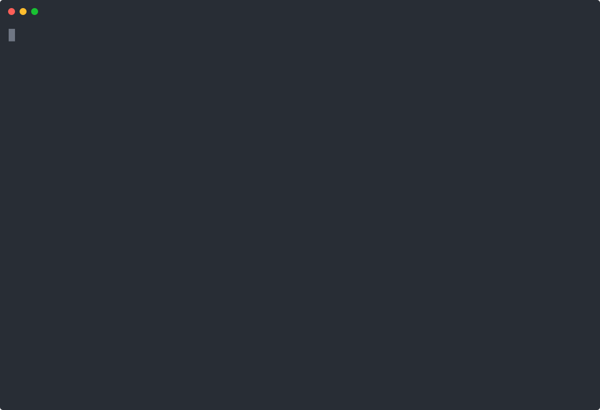

# codemode for Claude Code

A Claude Code mod that gives the model one tool, `mcp__codemode__run`: it
writes a JavaScript program, the program calls Claude Code's own tools
(`Read`, `Bash`, `Edit`, MCP tools — anything the session has), and only the
program's return value comes back into the conversation.



It ships with a `codemode` skill that tells the model when a program beats
direct calls and how to write one.

## Install

```text
/plugin marketplace add brianjmeier/claude-codemode
/plugin install codemode@claude-codemode
```

Or for one session: `claude --plugin-dir <this folder>`.

## What a program can do

| In the program | What it does | Shows in the row as |
| --- | --- | --- |
| `await tool(name, args)` | Calls any tool the session has: built-in (`Read`, `Edit`, `Bash`, `Glob`, `WebFetch`…) or MCP (`mcp__server__tool`), with the tool's usual arguments. Resolves `{ text, result, isError }`. | `✓ Read src/a.ts 12ms` |
| `await tools.Name(args)` | The same, for names that are valid identifiers. | |
| `await Promise.all([...])` | Runs calls in parallel; each keeps its own line and time. | one line per call |
| `await ask({ model, prompt })` | One question to a model (`haiku`, `sonnet`, …) with no tools; resolves its answer as text. Hand it the text it needs. | `✓ ask haiku summarize… 1.2s` |
| `await agent({ type, prompt })` | Starts a real subagent (`Explore`, `Plan`, a plugin's agent) and resolves `{ agentId }` at once. Its answer reaches Claude as a normal subagent hand-back, not the program. | `↗ Explore … started, reports to Claude` |
| `await canCall(name, args)` | What the permission check would decide (`"allow"`, `"ask"`, `"deny"`) without running anything. | |
| `await cwd()` | The session's working directory, for absolute paths. | |
| `await listTools()` | `[{ name, description }]` of everything callable. | |
| `log(...values)` | A line in the output Claude reads. | |
| `ToolDenied` | What a refused call or spawn throws (`error.tool`, `error.reason`). | `✗ Bash jj log denied` |

`return` a string to get it back verbatim, anything else as JSON; only that,
the log lines and a count of the calls reach the conversation. The row types
the program out while Claude writes it, then fills in each call as it runs.

### Not offered, and why

| Missing | Why |
| --- | --- |
| Waiting for a subagent's answer | A mod's tool call gets 10 s of its own time, and the plugin API has no call that waits for a subagent to finish; `agent()` therefore hands off, and `ask()` covers answers the program needs. |
| `tool("Agent", …)` | Claude Code refuses the Agent tool from a mod and requires `$.agent.spawn`, which is what `agent()` uses. |
| Its own filesystem, network, processes, env, `eval`, imports | Each would let a program act without the permission check. The same work goes through `Read`, `Write`, `Bash`, `WebFetch`… as tool calls. |
| Interrupting a synchronous infinite loop | The interpreter cannot be preempted; keep loops bounded by the data they walk. |

## Permissions and containment

- **Every nested call is a real tool call.** It goes through `$.tool.call`,
  the same path as the model's own calls: your allow/deny rules, auto mode,
  `PreToolUse` hooks and the permission dialog all apply, per call, with that
  call's own arguments.
- **The program has nothing else.** It runs in [sval](https://github.com/Siubaak/sval),
  a JavaScript interpreter written in JavaScript, inside the mod's own hooks
  runtime — which has no Node, no filesystem, no network, no process, and
  refuses `eval`, `Function` and WebAssembly. The interpreter is needed exactly
  because that runtime will not compile code from text. The program cannot
  reach the engine's `$`, and cannot start another program.
- **One limit beyond the table above:** the program shares the runtime's
  built-in prototypes, so it can monkey-patch `Array.prototype` for this mod's
  runtime (not the session, not the filesystem).

## Develop

```text
claude plugin validate .
claude plugin test .
```

`hooks/vendor/sval.js` is sval 0.6.12 (MIT), vendored unmodified.
